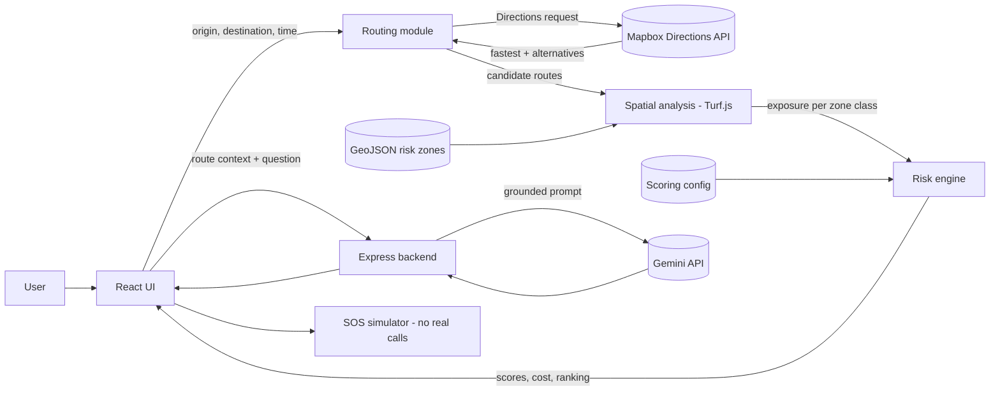
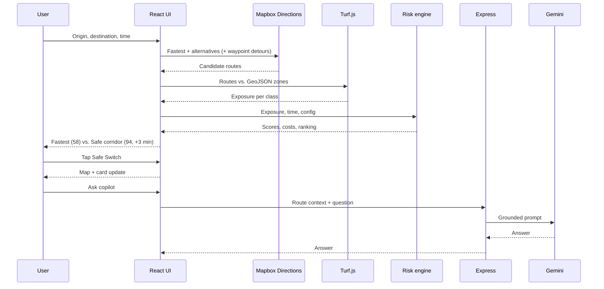

# SafeRoute Guardian — Architecture

Team Zephyr · Hackering 2.0 (Open Innovation) · Companion to the PRD
Items marked **(proposed)** are design choices not specified in the pitch deck.

---

## 1. Overview

SafeRoute Guardian adds a safety layer on top of standard routing. Given an origin, destination and time of travel, it fetches candidate routes, checks each against risk-zone polygons, scores them, and selects the route with the lowest **Route Cost = Travel Time + Risk Penalty**.

**Scope:** web MVP, Bengaluru demo area, synthetic GeoJSON risk zones, simulated SOS.

---

## 2. Tech Stack

| Layer | Technology | Role |
|---|---|---|
| Frontend | React, Tailwind CSS | UI, state, comparison card, copilot panel |
| Mapping | Mapbox GL JS, Mapbox Directions API | Map canvas, route fetching |
| Geospatial | Turf.js, GeoJSON | Route vs. zone intersection, exposure length |
| AI | Gemini API | Safety copilot |
| Backend | Node.js, Express | Key-hiding proxy, config, copilot endpoint |

---

## 3. System Diagram



---

## 4. Components

### 4.1 Frontend (React + Tailwind)

| Component | Responsibility |
|---|---|
| `SearchPanel` | Origin, destination, time-of-travel inputs |
| `MapCanvas` | Mapbox GL map, route layers, risk-zone overlay |
| `RouteComparisonCard` | Fastest vs. safe corridor: duration, score, delta |
| `SafeSwitchButton` | One-tap swap of active route |
| `CopilotPanel` | Chat with Gemini copilot |
| `SOSSimulator` | Step-by-step simulated alert flow (clearly labelled demo) |

State (single store or React context): `inputs`, `routes[]`, `analysis[]`, `activeRouteId`, `copilotMessages[]`.

### 4.2 Routing module

- Calls Mapbox Directions with `alternatives=true` for the fastest route plus alternatives.
- Generates extra **safer candidates (proposed)** by inserting waypoints that steer around Red zones (e.g., offset points around a zone's boundary) and re-requesting Directions.
- Output: list of routes `{ id, geometry (LineString), durationSec, distanceM }`.

### 4.3 Spatial analysis (Turf.js)

For each route and each zone polygon:

1. `turf.lineIntersect` / `turf.booleanIntersects` to detect crossing.
2. `turf.lineSplit` or `turf.lineSliceAlong` + `turf.booleanPointInPolygon` on sample points to compute the length inside the zone (`turf.length`).
3. Aggregate exposure in km per risk class.

Output: `{ routeId, exposureKm: { red, yellow, green }, crossedZones: [zoneId] }`.

### 4.4 Risk engine

Pure function, no I/O, so it is easy to unit-test and tune.

```
riskPenaltyMin = Σ over classes ( exposureKm[class] × weight[class] × timeMultiplier(t) × penaltyFactor )
routeCost      = travelTimeMin + riskPenaltyMin
safetyScore    = clamp( 100 − normalise(Σ exposureKm × weight × timeMultiplier), 0, 100 )
```

**Parameters (proposed, config-driven):**

| Parameter | Value |
|---|---|
| Zone weights | Red 3, Yellow 1.5, Green 0.5 |
| Time multiplier | day 1.0, evening 1.3, late night 1.6 |
| Show-safer threshold | safer route score ≥ fastest score + 10 |

Selection: lowest `routeCost` becomes the **safe corridor**; fastest route is the baseline for comparison.

### 4.5 Backend (Node.js + Express)

| Endpoint | Method | Purpose |
|---|---|---|
| `/api/config` | GET | Scoring weights, time bands, feature flags |
| `/api/zones` | GET | Synthetic GeoJSON risk zones |
| `/api/copilot` | POST | Forwards grounded prompt to Gemini, returns answer |
| `/api/health` | GET | Liveness check |

The backend keeps the **Gemini key** server-side. Mapbox public tokens are used in the browser (restrict by URL); a secret token, if ever needed, stays on the server.

**Where scoring runs (proposed):** client-side for instant Safe Switch, with weights fetched from `/api/config`. The engine is a shared pure module, so moving it server-side is a small change (`POST /api/score`).

### 4.6 Gemini safety copilot

- Input: structured context only — origin/destination labels, time band, per-route duration, score, crossed zones, exposure.
- System prompt rules: answer only from supplied data; say "safer" not "safe"; state that data is synthetic; no invented incident claims.
- Output: short plain-language explanation or suggestion.

### 4.7 SOS simulator

Frontend-only state machine: `idle → countdown → alert_sent → contacts_notified → help_dispatched (simulated)`. No network calls to contacts or emergency services.

---

## 5. Data Flow (Primary Journey)



---

## 6. Data Model

### 6.1 Risk zone (GeoJSON Feature)

```json
{
  "type": "Feature",
  "properties": {
    "id": "zone_001",
    "name": "Demo Zone A",
    "risk": "red",
    "baseWeight": 3,
    "timeModifiers": { "day": 1.0, "evening": 1.3, "night": 1.6 }
  },
  "geometry": { "type": "Polygon", "coordinates": [[[77.59, 12.97], "..."]] }
}
```

`timeModifiers` is optional **(proposed)**; the global multiplier applies if absent.

### 6.2 Route analysis result

```json
{
  "routeId": "fastest",
  "durationMin": 18,
  "exposureKm": { "red": 0.9, "yellow": 0.4, "green": 1.1 },
  "crossedZones": ["zone_001"],
  "riskPenaltyMin": 0,
  "routeCost": 0,
  "safetyScore": 58
}
```

Numeric fields above are placeholders except the duration and score, which match the deck's demo (18 min / 58; safe corridor 21 min / 94).

---

## 7. Suggested Repository Layout (proposed)

```
saferoute-guardian/
├── client/
│   └── src/
│       ├── components/        SearchPanel, MapCanvas, RouteComparisonCard, CopilotPanel, SOSSimulator
│       ├── lib/
│       │   ├── routing.js     Mapbox calls, waypoint detours
│       │   ├── spatial.js     Turf.js exposure computation
│       │   └── riskEngine.js  scoring (pure, unit-tested)
│       └── state/
├── server/
│   ├── index.js
│   ├── routes/                config, zones, copilot
│   └── data/zones.bengaluru.geojson
├── shared/                    scoring config defaults
└── docs/                      PRD.md, ARCHITECTURE.md
```

---

## 8. Configuration and Secrets

| Variable | Where | Notes |
|---|---|---|
| `VITE_MAPBOX_TOKEN` / equivalent public token | Client | Public token, URL-restricted |
| `GEMINI_API_KEY` | Server only | Never shipped to the client |
| `PORT` | Server | Default 3001 |
| `CORS_ORIGIN` | Server | Client origin only |

Name of the client env variable depends on the bundler you use.

---

## 9. Non-Functional Design

| Concern | Approach |
|---|---|
| Latency (≈3 s target) | Parallel Directions requests; precompute zone bounding boxes and prefilter with `turf.bbox` before intersection |
| Instant Safe Switch | All candidate analyses computed once; switch only changes `activeRouteId` |
| Resilience | If Directions fails, use cached demo routes; if Gemini fails, hide the copilot reply and show a retry message |
| Security | Server-side Gemini key, rate limiting and input-length cap on `/api/copilot`, CORS restricted |
| Privacy | No persistence of locations; session-only state |
| Transparency | UI badge: "Demo data is synthetic"; copy uses "safer", never "safe" |

---

## 10. Testing Strategy (proposed)

- **Unit:** `riskEngine` (known exposures → expected scores), `spatial` (fixture lines and polygons).
- **Fixture test:** seeded demo pair reproduces 18 min / 58 and 21 min / 94.
- **Manual:** time-of-day change alters scores; Safe Switch updates map and card; copilot refuses to invent facts; SOS makes no external calls.

---

## 11. Deployment (proposed)

- Client: static hosting (Vercel / Netlify).
- Server: any Node host (Render / Railway); single instance is enough for the demo.
- Local demo fallback: run client and server on localhost with cached routes.

---

## 12. Open Decisions

1. Safer-route generation: Directions alternatives only, waypoint detours, or custom graph search.
2. Client-side versus server-side scoring.
3. Exact normalisation for the 0–100 Safety Score.
4. Demo origin–destination pair and Bengaluru zone polygons.
5. Frontend build tool (the deck listed Vite; the PRD table now lists React and Tailwind only).
